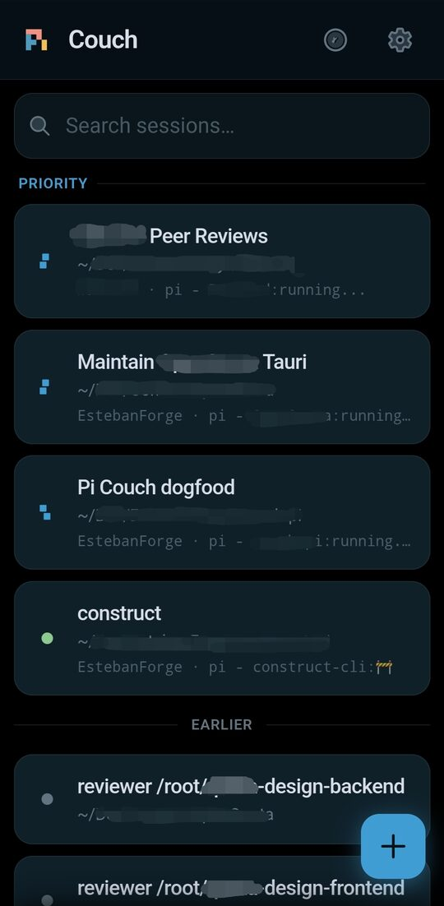
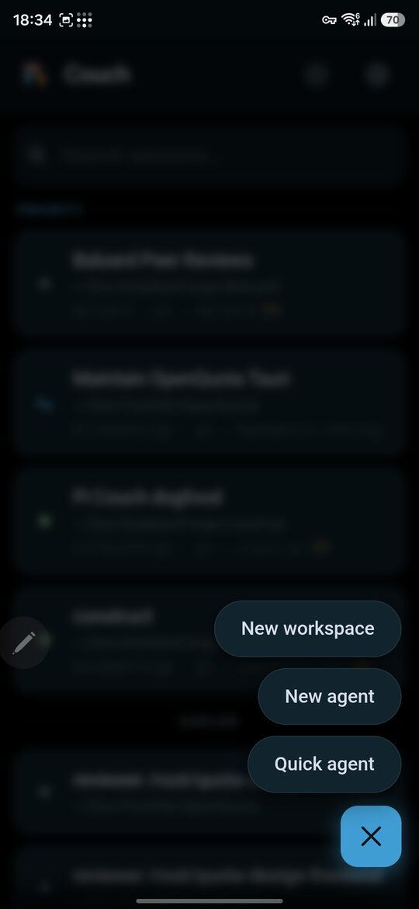
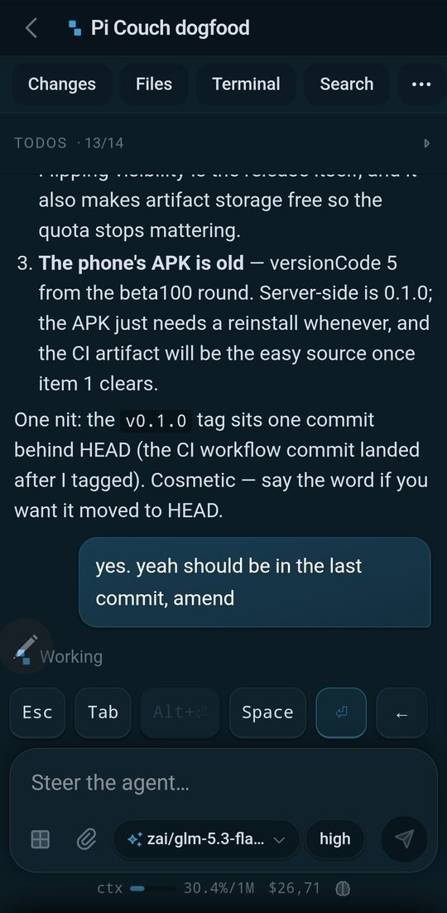
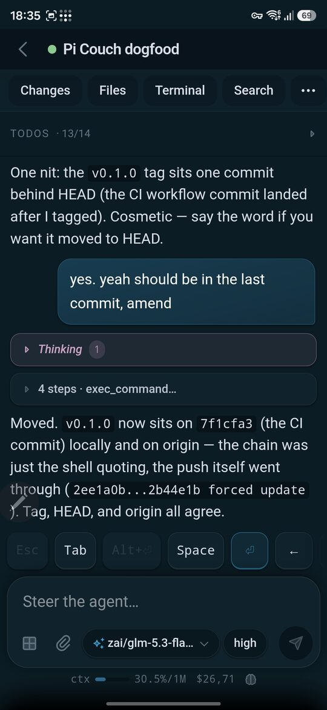

# Pi Couch

A phone client for the pi coding agents running on my server.

I work from the phone the same way I work from the desk. I open the app over Tailscale and every pi session on the machine is right there, including the ones I started over ssh. I read the transcript live, I steer, I answer dialogs and the commit gate, I review diffs and leave line comments, I peek at the terminal when I have to.

Back at the desk I retake control over ssh, and with herdr, all my sessions are still in place.

Nothing gets locked into the UI. Sessions stay plain pi jsonl files, herdr stays the only driver, and the phone is just another client. If I delete the app tomorrow I lose a viewer, not my work.

| | |
|---|---|
|  |  |
|  |  |

## Running it

The honest requirements: a Linux or macOS box (Windows WSL also works) with [pi](https://pi.dev) 1.x.x and [herdr](https://herdr.dev) 0.9.x on it, and a tunnel. I use [Tailscale](https://tailscale.com) and nothing else; it puts a private HTTPS address on the whole thing with zero config beyond the serve line below. herdr drives the sessions; Pi Couch speaks its socket protocol and nothing else.

The server binds 127.0.0.1 and trusts whatever sits in front of it. I front mine with `tailscale serve --bg --https=48443 8090` and set `origin` in the config to the public URL, so cross-site posts get rejected.

One suggestion from me: [herdrui.dev](https://herdrui.dev) is an optional desktop app for Windows, Linux and macOS, a nice integrated UI with the full terminal power. You install herdr anyway, so it's just a convenience on top.

### Installation

Releases carry compiled binaries, so most people just grab one from the [releases page](https://github.com/EstebanForge/pi-couch/releases) and skip the build. Building from source:

```sh
./scripts/build.sh              # builds the SPA, then the binary
bin/couch-pi --addr 127.0.0.1:8090
curl localhost:8090/healthz     # ok
```

Two wiring steps. First, the dialog bridge (pi loads extensions at agent start, so restart your agents after linking it):

```sh
ln -sf $PWD/extensions/couch-pi-bridge.ts ~/.pi/agent/extensions/couch-pi-bridge.ts
```

Second, [skydiver/herdr-pinned-workspaces](https://github.com/skydiver/herdr-pinned-workspaces), the one herdr plugin I run. herdr owns a workspace only while it holds a tab; close the last one and the workspace is gone. The plugin keeps your declared workspaces alive: recreated the moment they die and on every herdr start, so the set you build from the phone survives restarts and stray exits.

```sh
herdr plugin install skydiver/herdr-pinned-workspaces
```

One more I'd add: [@tangentyh/pi-auto-rename](https://www.npmjs.com/package/@tangentyh/pi-auto-rename), a pi extension. After the first prompt it makes a background model call and names the session (and the herdr pane) from the conversation, so the home list reads like something a human wrote instead of raw paths. Anything it names you can still rename by hand from the chat; the auto name is just the starting point.

```sh
pi install npm:@tangentyh/pi-auto-rename
```

Last, the service. `systemd/couch-pi.service` is a user unit on Linux: copy it to `~/.config/systemd/user/`, then `systemctl --user daemon-reload && systemctl --user enable --now couch-pi`.

### Serving it over Tailscale

`tailscale serve` fronts the loopback server with a real certificate on your tailnet. With the server running:

```sh
tailscale serve --bg --https=48443 8090
curl https://yourbox.your-tailnet.ts.net:48443/healthz   # ok
```

The first time, Tailscale asks you to enable HTTPS for the tailnet and provisions the cert for you.

Last wiring step: tell Pi Couch its public address, because the cross-site guard only accepts the host you declare. Copy the example config and set `origin` (every key is explained in Configuring it below):

```sh
mkdir -p ~/.config/pi-couch
cp pi-couch.example.toml ~/.config/pi-couch/config.toml
```

```toml
origin = "https://yourbox.your-tailnet.ts.net:48443"
```

Restart the service if it was already up (`systemctl --user restart couch-pi`), and the box is done.

For the phone, grab the signed APK from the [releases](https://github.com/EstebanForge/pi-couch/releases/latest) page and sideload it. A mobile browser works fine too; the APK just behaves better with safe areas and a launcher icon. For updates I recommend [Obtainium](https://obtainium.imranr.dev/): point it at this repo and it installs new versions from the releases feed for you. The first-run screen asks for the server address: the MagicDNS name of your box, from the Tailscale app's device page, is exactly what it wants. If your server runs with a token, that same screen takes it.

Building it yourself works too: `./gradlew assembleRelease` under `android/`. Without a signing keystore it falls back to a debug key, fine for a test install.

## Configuring it

Machine settings live in one commented file, `~/.config/pi-couch/config.toml`. Copy `pi-couch.example.toml` there and edit. Every key is optional; run with no file and you get safe defaults. Command-line flags (`--addr`, `--origin`, `--sessions`) override the file when you just want to poke at something.

- `addr`: where the HTTP server listens. Keep it on loopback; the tunnel fronts TLS. Defaults to `127.0.0.1:8090`.
- `origin`: the public URL your phone uses, e.g. `https://yourbox.your-tailnet.ts.net:48443`. The cross-site guard accepts exactly this host, so set it, or state-changing requests only work from loopback.
- `sessions_dir`: where pi writes sessions. Defaults to `~/.pi/agent/sessions`, which is what you want.
- `uploads_dir`: where attachments land before their paths get pasted into messages. Defaults to `/tmp/pi-couch-uploads`; the pi agents on the same machine read them from there.
- `memory_url` and `memory_secret`: the agentmemory health probe behind the chip in the composer. Defaults to `localhost:3111`; set the URL if yours is elsewhere. Put the secret in the `AGENTMEMORY_SECRET` environment variable instead of the file, and keep the file 0600 either way.
- `access_token`: the shared secret gating the API and streams. Leave it empty and export `PICOUCH_ACCESS_TOKEN` instead so the secret never sits in a file; the env var wins.
- `enforce_token`: refuse to start when no token is set. Defaults to true; set false only if you understand the tunnel is then the only lock.

The environment variables `AGENTMEMORY_URL` and `AGENTMEMORY_SECRET` override the config values; that's how I wire the secret into the systemd unit without it touching the repo.

The same goes for the token, and where the env var goes depends on how you run the server. The one rule underneath all of this: exports in your shell rc files never reach a service.

Quick run from a terminal (macOS or Linux), the export is enough:

```sh
export PICOUCH_ACCESS_TOKEN=your-token
bin/couch-pi
```

Linux with the systemd unit: the service reads `~/.config/couch-pi/env`, one `KEY=value` per line. Put the token there and restart; the file is read at start, no reload needed.

```sh
echo 'PICOUCH_ACCESS_TOKEN=your-token' >> ~/.config/couch-pi/env
chmod 600 ~/.config/couch-pi/env
systemctl --user restart couch-pi
```

macOS with a LaunchAgent: launchd skips shell rc files too. Either run the binary from a terminal with the export, or teach the agent the variable in its plist:

```xml
<key>EnvironmentVariables</key>
<dict>
    <key>PICOUCH_ACCESS_TOKEN</key>
    <string>your-token</string>
</dict>
```

Then reload the agent (`launchctl bootout gui/$(id -u)/<label>` and `launchctl bootstrap gui/$(id -u) ~/Library/LaunchAgents/<label>.plist`) so it starts with the variable in place.

## Security

There's no login; there's a shared token, and it's on by default. Set `PICOUCH_ACCESS_TOKEN` in the environment (or `access_token` in the config) and every API and stream request must carry it; the phone asks for it on the first-run screen. With enforcement on (the default) the server refuses to start without a token, so an open deployment is always a deliberate choice: `enforce_token = false` in the config turns the requirement off.

The rest of the model is the tunnel: the server only listens on loopback, and whatever can reach the tunneled address can drive your agents (read, steer, run commands, commit). Mine is Tailscale, so the address is reachable only inside my tailnet, and the tailnet is the trust boundary on top of the token. That's the entire model.

Don't port-forward this to the public internet; that hands your machine to anyone who finds the port. If you need exposure beyond a private tunnel, put a reverse proxy with auth in front before you blame the door you left open.

## Notes

Tested against pi 1.3.x and herdr 0.9.5. Dialog answering reads the pane paint, so a pi TUI reshuffle can break it. The rest of the client reads the session files, which move much slower.

State lives in `~/.local/state/couch-pi` (models cache, push subscriptions). No database, no accounts, one user. It's my setup, extracted and released as-is.

Built on [pi](https://earendil.com) and herdr.

MIT, see [LICENSE](LICENSE).
